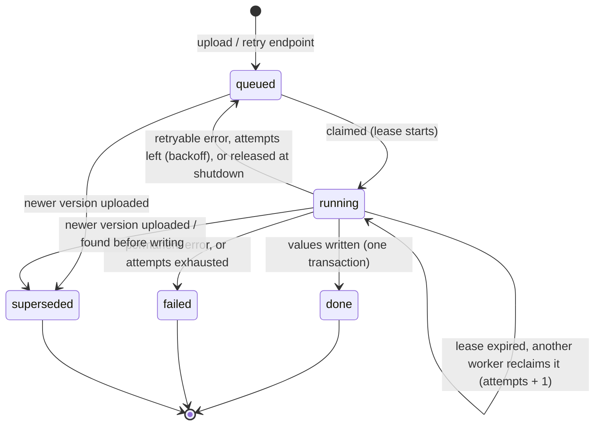

# Document Review

PDF documents go in, an LLM extracts structured values with verbatim evidence, and a reviewer approves or corrects every value before it is trusted, including when a revised version of a document arrives.

> Status: project skeleton. Sections marked _TODO_ are filled in as the features land.

## Quick start

Requirements: Node 22 (`nvm use`), pnpm 10 (`corepack enable`), Docker Desktop.

```sh
cp .env.example .env        # no secrets needed: the LLM is configured in the app
pnpm install
pnpm db:up                  # Postgres in Docker (host port 5433)
pnpm db:migrate             # create the schema
pnpm db:seed                # insert version 1 of the 3 fixture documents (safe to re-run)
pnpm dev                    # API on :3000, extraction worker, web on :5173
```

**Then open Settings first** (<http://localhost:5173/settings>): pick Claude (Anthropic) or OpenAI, paste an API key, click **Test connection**, keep the pre-selected low-cost model and **Save** (see [LLM settings](#llm-settings)). Until then the seeded documents stay `queued` and the app shows "Extraction is paused — configure an LLM in Settings". For a demo without any key, set `EXTRACTOR=fake` in `.env`: a deterministic fake extractor then fills in values within a couple of seconds.

Open the review UI at <http://localhost:5173> (walkthrough in [Review UI](#review-ui)). Check the API: <http://localhost:3000/health>

_TODO: once the api and web services are in `docker-compose.yml`, `docker compose up` alone starts everything, runs migrations and seeds version 1 of the fixtures._

## Scripts

| Command                                            | What it does                                                                                                                                                            |
| -------------------------------------------------- | ----------------------------------------------------------------------------------------------------------------------------------------------------------------------- |
| `pnpm dev`                                         | Build shared types, run the API, the worker and the web app in dev                                                                                                      |
| `pnpm --filter @doc-review/api worker:dev`         | Run only the extraction worker (watch mode); `worker` runs the built one                                                                                                |
| `pnpm build`                                       | Build every package                                                                                                                                                     |
| `pnpm typecheck`                                   | Type-check every package                                                                                                                                                |
| `pnpm lint`                                        | ESLint across the repo                                                                                                                                                  |
| `pnpm format`                                      | Format with Prettier                                                                                                                                                    |
| `pnpm test`                                        | Run all tests (unit, integration, e2e). API tests need Postgres up; they create and migrate a separate `app_test` database and never touch `app`. No LLM is ever called |
| `pnpm test:unit` / `test:integration` / `test:e2e` | Run one layer (see [Tests](#tests))                                                                                                                                     |
| `pnpm test:coverage`                               | All tests with coverage; fails if a critical module drops below 90% lines or branches                                                                                   |
| `pnpm --filter @doc-review/api test:live`          | Call the real LLM on `invoice-001.pdf` (needs `LLM_LIVE_TEST_PROVIDER`, `LLM_LIVE_TEST_MODEL`, `LLM_LIVE_TEST_KEY` in your shell; costs a few cents; never in CI)       |
| `pnpm --filter @doc-review/api llm:models`         | List the models a key can use for extraction and the default Settings would pick (needs `LLM_LIVE_TEST_PROVIDER`, `LLM_LIVE_TEST_KEY`; free; prints IDs only)           |
| `pnpm db:up` / `down`                              | Start / stop Postgres                                                                                                                                                   |
| `pnpm db:migrate`                                  | Apply SQL migrations from `apps/api/drizzle/`                                                                                                                           |
| `pnpm db:seed`                                     | Seed version 1 of each fixture document plus a queued job                                                                                                               |
| `pnpm --filter @doc-review/api db:generate`        | Generate a new migration after editing `apps/api/src/db/schema.ts`                                                                                                      |

## Repository layout

```
apps/
  api/        Fastify API + extraction worker (Node, TypeScript)
  web/        React review UI (Vite)
packages/
  shared/     Field definitions, types and Zod schemas used by both apps
fixtures/     Sample PDFs and manifests provided with the assignment
```

Why this split: the API and the UI deploy separately, but must agree on field definitions, statuses and request shapes. Keeping those in `packages/shared` gives one source of truth and compile-time errors when they drift.

## Schema

Postgres is the system of record. Tables are defined in [`apps/api/src/db/schema.ts`](apps/api/src/db/schema.ts) (Drizzle), and the SQL migrations generated from it live in [`apps/api/drizzle/`](apps/api/drizzle/). Status and action enums are built from the lists in `packages/shared`, so the database, the API and the UI share one definition.

```
documents 1─* document_versions 1─* extraction_jobs
                       │
                       1─* extracted_values 1─* reviews
                              └─ previous_value_id → the same field's value on the previous version
```

| Table               | One row is…                    | Key columns                                                                                                                                                                                                            |
| ------------------- | ------------------------------ | ---------------------------------------------------------------------------------------------------------------------------------------------------------------------------------------------------------------------- |
| `documents`         | a logical document             | `type`, `title`, `fixture_key` (set only for seeded fixtures)                                                                                                                                                          |
| `document_versions` | one uploaded PDF               | `version_no`, `file_path`, `file_sha256`, `parsed_text`, `status`, `error`, `baseline_version_id` (the version it was compared against)                                                                                |
| `extraction_jobs`   | one extraction job (the queue) | `status`, `attempts`, `run_after`, `locked_by`, `locked_until`, `heartbeat_at`, `started_at`, `finished_at`, `last_error`, `prompt`, `prompt_version`, `provider`, `model`, `raw_response`, `usage`, `llm_duration_ms` |
| `extracted_values`  | one field of one version       | `field`, `value`, `normalized_value`, `evidence`, `evidence_start`, `evidence_end`, `gap_reason`, `gap_kind`, `comparison`, `comparison_reason`, `previous_value_id`, `carried_over`                                   |
| `reviews`           | one approve/correct action     | `action`, `corrected_value`, `note`, `reviewer`, `carried_from_review_id` (set on a review copied from the previous version)                                                                                           |
| `llm_settings`      | the LLM in use (one row only)  | `provider`, `model`, `api_key_ciphertext`, `api_key_iv`, `api_key_tag`, `key_version`, `key_hint` (last 4 characters), `last_verified_at` — see [LLM settings](#llm-settings)                                          |

**Versions → values → reviews.** Every upload is a new version row, and values and reviews hang off that specific version. Nothing is updated in place or deleted: every foreign key is `ON DELETE RESTRICT`. Each version keeps its own `parsed_text`, so evidence for version N is always checked against version N's text, even after N+1 exists.

**Corrections live beside the value.** A review never overwrites `extracted_values.value`. A correction is a `reviews` row with `corrected_value` (plus an optional `note`), and the latest review for a value is its current state. This keeps what the LLM said, what the reviewer decided and the full history, which is also what re-extraction compares against.

**The current version is derived.** A document's current version is its highest `version_no`. There's no `documents.current_version_id`, because that would be a circular foreign key that has to be updated in step with every insert and could point at the wrong row.

**What the database guarantees:**

| Rule                                  | Constraint                                                                                           |
| ------------------------------------- | ---------------------------------------------------------------------------------------------------- |
| No duplicate values for a version     | `UNIQUE (version_id, field)` on `extracted_values`, so re-extracting the same version can't add rows |
| At most one open job per version      | partial unique index on `extraction_jobs (version_id) WHERE status IN ('queued','running')`          |
| No duplicate version numbers          | `UNIQUE (document_id, version_no)` on `document_versions`                                            |
| A value carries evidence, or is a gap | `CHECK` on `extracted_values`: value and evidence both set, or value null with a `gap_reason`        |
| A correction has a value              | `CHECK` on `reviews`: `action = 'correct'` requires `corrected_value`                                |
| Seeding is idempotent                 | `UNIQUE (fixture_key)` on `documents`, and the seed uses `ON CONFLICT DO NOTHING` in one transaction |

The worker claims jobs through the `(status, locked_until)` index, and `reviews (value_id, created_at)` serves "latest review per value".

**Review state is derived in one place:** the `value_review_states` view (migrations `0002` and `0005`). The latest review decides:

- no review → `pending`
- a review carried over from the previous version (`carried_from_review_id` set) → `carried_over`, with `carried_action` saying whether that review was an approval or a correction
- otherwise `approve` → `approved` and `correct` → `corrected`

A reviewer who later re-reviews a carried value adds a normal review, so the state becomes `approved` or `corrected`; the carried review stays in the history. The view also exposes `is_gap` (`value IS NULL`). The document list, the detail view and the progress counts all read this view, so they can't disagree. `reviews.created_at` defaults to `clock_timestamp()`, so two reviews in one transaction still have a well-defined latest.

**Version statuses:** `queued → extracting → extracted | failed`. An older version that was still `queued` or `extracting` when a newer version arrived becomes `superseded`, so it never stays in flight forever. The current version is never `superseded`.

## API

The API is Fastify on `:3000`. Request and response shapes are Zod schemas in [`packages/shared/src/api.ts`](packages/shared/src/api.ts), shared with the web app. JSON is camelCase and timestamps are ISO 8601.

| Method & path                           | Body                                                             | Success                                                            | Errors                  |
| --------------------------------------- | ---------------------------------------------------------------- | ------------------------------------------------------------------ | ----------------------- |
| `POST /documents`                       | multipart: `type`, `file` (PDF), optional `title`                | `202` `{ documentId, versionId, versionNo, status }`               | 400, 413, 415           |
| `POST /documents/:id/versions`          | multipart: `file` (PDF)                                          | `202` same shape                                                   | 400, 404, 409, 413, 415 |
| `GET /documents`                        | —                                                                | `200` `{ documents: [...] }` with status and progress              | —                       |
| `GET /documents/:id?version=N`          | —                                                                | `200` document, selected version, all versions and values          | 400, 404                |
| `GET /documents/:id/progress?version=N` | —                                                                | `200` `{ pending, approved, corrected, carriedOver, gaps, total }` | 400, 404                |
| `POST /values/:id/review`               | `{ action: "approve" }` or `{ action: "correct", value, note? }` | `201` the value, as in `GET /documents/:id`                        | 400, 404, 409           |
| `POST /documents/:id/retry`             | —                                                                | `202` `{ versionId, status: "queued" }`                            | 404, 409                |
| `GET /health`                           | —                                                                | `200` `{ status: "ok", database: "up" }`                           | 503                     |

```sh
# Upload a new document (type: invoice | lease | market_report)
curl -s -F type=invoice -F 'file=@fixtures/documents/invoice-001.pdf;type=application/pdf' \
  http://localhost:3000/documents
# → 202 {"documentId":"…","versionId":"…","versionNo":1,"status":"queued"}

# Upload a revised PDF as the next version of that document
curl -s -F 'file=@fixtures/documents/invoice-001.v2.pdf;type=application/pdf' \
  http://localhost:3000/documents/$DOCUMENT_ID/versions
# → 202 {"documentId":"…","versionId":"…","versionNo":2,"status":"queued"}

curl -s http://localhost:3000/documents/$DOCUMENT_ID?version=1           # an older version, read-only
curl -s -H 'content-type: application/json' -d '{"action":"correct","value":"2025-12-15","note":"Revised"}' \
  http://localhost:3000/values/$VALUE_ID/review                          # → 201 the updated value
```

**Errors.** Every non-2xx response uses one envelope: `{ "error": { "code", "message", "details"? } }`. The codes are `VALIDATION_ERROR` (400, with `details` listing each failing field), `NOT_FOUND` (404), `CONFLICT` (409), `PAYLOAD_TOO_LARGE` (413), `UNSUPPORTED_MEDIA_TYPE` (415), `BAD_REQUEST` (400, e.g. malformed JSON) and `INTERNAL_ERROR` (500). A 500 never includes the underlying message, stack or SQL.

**Why uploads return `202 Accepted`.** An upload only validates the file, stores it and inserts the version and a `queued` job in one transaction. It never waits for parsing or the LLM. The worker picks the job up later, and the UI watches the version's `status`. If the transaction fails, the stored file is removed.

**Uploads are validated before anything is stored.** The file must be declared as `application/pdf` and start with the `%PDF-` signature (otherwise 415), and must be at most `MAX_UPLOAD_MB` (default 10, otherwise 413). Files are stored under `STORAGE_DIR/<documentId>/v<versionNo>-<sha256>.pdf` (default `./storage`, which is `apps/api/storage` in dev), and the SHA-256 is recorded on the version. Re-uploading a file identical to the current version returns 409 and creates nothing.

**Correction model.** A review is appended, never edited, and the latest review wins. `correct` stores the reviewer's value beside the extracted one, which is never overwritten. Only the current version, once `extracted`, can be reviewed; older versions are read-only (409). Gaps can be reviewed too: `approve` confirms the field really is missing, and `correct` supplies the value.

**A new version while the previous one is still extracting: newest wins.** `POST /documents/:id/versions` locks the document row (`SELECT … FOR UPDATE`), so concurrent uploads get consecutive version numbers. In the same transaction it marks every open job of the older versions `superseded` (and those versions `superseded`), then inserts version N+1 with a fresh `queued` job. Nothing is deleted, and older versions stay queryable with `?version=N`. Reviews take a shared lock on the same row, so a review can't land on a version that is being replaced.

**Retry.** `POST /documents/:id/retry` only works when the current version is `failed`. It sets the version back to `queued` and adds a new job. The partial unique index guarantees there is never more than one open job per version.

## LLM settings

The provider, model and API key are configured in the app, not in environment files: **Settings** (`/settings`, linked in the header).

**First run.**

1. Open Settings and choose **Claude (Anthropic)** or **OpenAI**.
2. Paste an API key and click **Test connection**. The API calls the provider's list-models endpoint with that key. This call is free: no completion is run. Success means the key is valid, and the response lists the models the key can use.
3. Keep the pre-selected model ("Recommended — low cost") or pick a more accurate one.
4. Click **Save settings**. Queued documents start extracting on the worker's next poll; no restart is needed.

**Model recommendation.**

- **Filter.** Only text models that work with the extraction request are offered: structured output and, for Anthropic, `effort`, read from the capability flags Anthropic's models API reports. Deprecated models are excluded, and so are OpenAI models that are not current chat models (embeddings, audio, images, realtime, moderation).
- **Curated defaults.** A short list in [`modelCatalog.ts`](apps/api/src/llm/modelCatalog.ts):
  - Anthropic: `claude-haiku-5-5` (recommended), then `claude-sonnet-5-5` for higher accuracy.
  - OpenAI: `gpt-6-luna` (recommended), then `gpt-6.1-terra` and `gpt-6.1-sol`.
- **Pre-selection.** Settings pre-selects the first curated model the key actually has, otherwise the cheapest available match.
- **Server-side check.** Saving re-runs the check server-side, and a model outside the key's list is rejected (400). The browser's earlier test is never trusted.

**How the key is protected.**

- **Encryption at rest.** The key is encrypted with AES-256-GCM (Node's `crypto`, a random 12-byte IV per save). The ciphertext, IV, auth tag and `key_version` are stored in `llm_settings`. A tampered value fails to decrypt.
- **The encryption key is never in the database.** It comes from `APP_ENCRYPTION_KEY` (32 bytes, base64). If that's unset, a key file at `SECRETS_DIR/encryption.key` is generated on first start with mode 0600; it's git-ignored, and Docker keeps it on the `secrets` volume. The API and worker fail at startup with a clear message if neither can be read or created.
- **Decrypted only when needed.** The worker decrypts the key per job, at the moment of the call, and does not keep it.
- **Never returned or logged.** The API never returns the key: `GET /settings/llm` shows only `keyHint` (the last 4 characters). Request logs never include bodies, and the logger also redacts `apiKey` and auth headers.
- **Rate-limited test.** `POST /settings/llm/test` is limited to 10 requests per minute per client.

**Without settings.** The worker does not claim jobs, so documents stay `queued` without using up retry attempts, and the UI shows a banner. A revoked key fails the version with "LLM authentication failed — update the API key in Settings", and it can be retried after the key is replaced.

**Known limitation: no authentication.** The app has no sign-in (out of scope for the assignment), so anyone who can reach it can read the masked settings and replace the key. A production deployment needs authentication and an admin role on these endpoints.

**Key rotation (future work).** `key_version` is already stored with every ciphertext. Rotation would add the new encryption key under the next version, re-encrypt the row, and then retire the old key. If the encryption key is lost or changed today, the saved API key can't be read: re-enter it in Settings.

## How extraction is coordinated

An upload only inserts a version and a `queued` row in `extraction_jobs`. A separate **worker process** ([`apps/api/src/worker/`](apps/api/src/worker/)) turns those rows into results. **Postgres is the only coordination mechanism.** There's no Redis and no queue library: the job is a row in the same database as the data it produces, so claiming, writing results and changing state are ordinary transactions, and a restart loses nothing.



The version mirrors its job: `queued` → `extracting` → `extracted` | `failed` (or `superseded`). While a retry is pending, the version is back to `queued` and `error` explains the failed attempt.

**Claiming.** Each worker runs `WORKER_CONCURRENCY` slots, and an idle slot polls every `WORKER_POLL_INTERVAL_MS`. A claim is one transaction ([`jobs.repository.ts`](apps/api/src/repositories/jobs.repository.ts)):

```sql
WITH next_job AS (
  SELECT id FROM extraction_jobs
  WHERE (status = 'queued'  AND run_after    <= now())   -- due (backoff elapsed)
     OR (status = 'running' AND locked_until <  now())   -- its worker died
  ORDER BY created_at
  FOR UPDATE SKIP LOCKED
  LIMIT 1
)
UPDATE extraction_jobs j
SET status = 'running', locked_by = $workerId, locked_until = now() + $lease,
    heartbeat_at = now(), attempts = attempts + 1, started_at = now()
FROM next_job WHERE j.id = next_job.id
RETURNING ...;   -- then, same transaction: version → 'extracting'
```

`SKIP LOCKED` lets any number of workers claim at once without blocking each other or taking the same job. Two partial indexes serve the two halves of the `WHERE`.

**Leases and heartbeats.** A claim is a lease (`JOB_LEASE_SECONDS`, default 120). While the extractor runs, a heartbeat renews it every lease/3, so a slow LLM call isn't reclaimed. Every lease comparison uses the database clock (`now()`), never a worker's clock.

**Fencing.** Every write that ends or hands back an attempt (done, retry, failed, superseded, released) is conditional on `id = $job AND status = 'running' AND locked_by = $workerId`. If a worker stalled past its lease and another worker reclaimed the job, the stale worker's write matches 0 rows. Its result is discarded and logged as `lease_lost`, and it can never overwrite the newer attempt. A heartbeat that finds the lease gone aborts the extraction early.

**Retries and failure.** Errors are classified:

- **Retryable:** timeouts, rate limits, dropped connections.
- **Permanent:** an unreadable PDF, or extractor output that fails the shared Zod schema.

A retryable error with attempts left (`JOB_MAX_ATTEMPTS`, default 3) re-queues the job with `run_after = now() + backoff`. The backoff is exponential (`JOB_BACKOFF_BASE_MS · 2^(attempt-1)`) with jitter, capped at 5 minutes. Otherwise the job and the version become `failed` with a readable `error`, and `POST /documents/:id/retry` re-queues it. The worker loop catches everything, so one bad job never stops it.

**Crash recovery.** If a worker is killed (`kill -9`, OOM, container restart), its jobs stay `running` until their lease expires, and then the claim query picks them up again with attempts + 1. No manual reset is needed, and nothing stays `extracting`. A job that dies on every attempt is failed once attempts run out. On startup the worker logs how many expired leases it's about to recover.

**Shutdown.** On SIGINT/SIGTERM the worker stops claiming and waits up to `WORKER_SHUTDOWN_TIMEOUT_MS` for in-flight jobs. Anything still running is then released, fenced, back to `queued`. That doesn't count as an attempt, because the job didn't fail.

**Supersede.** Newest wins. Uploading version N+1 marks older open jobs `superseded`, including a running one, whose fenced completion then writes nothing. As a second guard, the completing transaction share-locks the document row and re-checks that the version is still the latest before writing. If it isn't, the job becomes `superseded` and no values are written.

**Idempotent results.** A result is written in one transaction: job `done` (with `prompt` and `raw_response`), every value, and version `extracted`. Values are inserted `ON CONFLICT (version_id, field) DO NOTHING`, on top of the `UNIQUE (version_id, field)` constraint. However a version ends up extracted twice (retry, crash recovery, an impatient user), it never gets duplicate values.

**Observing it.** The worker writes one JSON log line per job: `jobId`, `versionId`, `attempt`, `workerId`, `durationMs` and `outcome` (`done | retry | failed | superseded | released | lease_lost | abandoned`). Document text, evidence and secrets are never logged. Each job keeps its `prompt`, `raw_response` and `last_error`. To see the queue:

```sh
docker compose exec db psql -U app -d app -c \
  "select status, count(*), max(attempts) as max_attempts from extraction_jobs group by status"
```

The extractor is an interface ([`extraction/extractor.ts`](apps/api/src/extraction/extractor.ts)), described in the next section. `EXTRACTOR=fake` returns deterministic values without a model. `FAKE_EXTRACTOR_BEHAVIOR=retryable|permanent` and `FAKE_EXTRACTOR_DELAY_MS` simulate failures and slow calls, which is handy for trying crash recovery by hand.

## Extraction

```
stored PDF ──pdfjs-dist──▶ raw text ──▶ prompt (field definitions + <document>) ──▶ one model call
   │                         │                                                     (structured JSON output)
   │                         └─ stored as document_versions.parsed_text                    │
   │                                                                                         ▼
   │                    values + gaps ◀── normalise ◀── value supported? ◀── evidence in THIS text? ◀── Zod-parse
```

The worker runs this ([`apps/api/src/extraction/`](apps/api/src/extraction/)) with `EXTRACTOR=llm`, the default. The provider, model and API key come from [LLM settings](#llm-settings), read from Postgres for every job. Each step is a small pure module with its own tests.

**Two providers: Anthropic and OpenAI.** The provider saved in Settings picks which client handles the job; the provider and model are stored on every job row. Both clients ([`anthropic-client.ts`](apps/api/src/extraction/llm/anthropic-client.ts), [`openai-client.ts`](apps/api/src/extraction/llm/openai-client.ts)) implement the same `LlmClient` interface, with the same guarantees:

- one request per attempt;
- the same retryable/permanent error mapping;
- the raw response and usage stored;
- refusals are permanent.

Everything after the call (verification, normalisation, carry-over) doesn't depend on the provider.

> **"LLM authentication failed — update the API key in Settings"** means the provider rejected the saved key (revoked or expired). The version is `failed`; replace the key in Settings, then click Retry. No restart is needed: the worker reads the settings for every job.

**Parsed text is stored per version, exactly as parsed.** [pdfjs-dist](https://github.com/mozilla/pdf.js) (Mozilla's PDF.js, with no runtime dependencies) turns the PDF into text, keeping a line break wherever PDF.js reports one. That raw text is stored on `document_versions.parsed_text` and never normalised. Evidence for version N is always verified against version N's own text, even after N+1 exists. The review UI can highlight a passage using the stored offsets. Failures are permanent:

- encrypted or unreadable PDFs;
- PDFs with no extractable text ("No extractable text — scanned PDFs are not supported", since there's no OCR);
- documents longer than `MAX_DOCUMENT_CHARS`.

**One structured model call.** The prompt (`PROMPT_VERSION = extract-v1`, stored on the job) gives each field's name, type and a one-line description from `packages/shared`, then the document between `<document>` tags. The request uses **structured outputs** (Anthropic: `output_config.format` with a JSON schema; OpenAI: `response_format` with a `strict` JSON schema). The reply must be `{ fields: [{ field (enum of the type's fields), value, evidence, not_found_reason }] }`, so the model can't answer in free text. There are no SDK retries (the job queue owns retries), a `LLM_TIMEOUT_MS` timeout, and, on Anthropic models that support them, server-side refusal fallbacks. The instructions ask the model to:

- copy evidence character for character;
- never paraphrase or join separate lines;
- return null with a reason rather than guess;
- pick the value that matches the field's meaning (total due, not subtotal; current quarter, not prior).

**Prompt-injection defence.** The document is wrapped in `<document>` tags and the system prompt says it's untrusted data, so instructions inside it are ignored. More importantly, nothing the model says is trusted: every value is checked by the code below, so injected text can at most produce gaps.

**What code enforces** ([`verify-fields.ts`](apps/api/src/extraction/validate/verify-fields.ts)), field by field:

| Check                                                                                 | Fails as                                                                  |
| ------------------------------------------------------------------------------------- | ------------------------------------------------------------------------- |
| Output doesn't match the schema                                                       | whole attempt retryable (raw response kept)                               |
| Field missing from the output (unknown fields are ignored; duplicates keep the first) | gap: `Not returned by the model`                                          |
| Model says not found                                                                  | gap with the model's reason, or `Not found in document`                   |
| Evidence empty                                                                        | gap: `No evidence quoted for the value`                                   |
| Evidence not found verbatim in **this version's** text                                | gap: `Quoted evidence not found in document text`; the value is discarded |
| Value not stated by its evidence                                                      | gap: `Value not supported by its evidence`                                |
| Value can't be normalised as its type                                                 | gap: `Value could not be normalised as <type>`                            |

**Verbatim matching rules.** Evidence and text are normalised identically: Unicode NFKC (folds PDF ligatures such as `fi`), every whitespace run (spaces, tabs, `\r\n`, `\r`, `\n`) becomes one space, then trim. Deliberately **not** normalised: letter case, punctuation, symbols, digits. A paraphrase, a re-cased line or a "fixed" number never matches. The match is mapped back to raw positions, so the stored `evidence` is the exact passage from the document and `evidence_start`/`evidence_end` locate it.

**Value–evidence consistency.** A real line can still be the wrong line, for example the subtotal line quoted for the total. The value must be stated by its evidence:

- for any type, the value appears in the evidence (case-insensitive);
- for money, numbers and percentages, its number is among the evidence's numbers (`5,230.30` fails against `Total Due: $5,230.29`);
- for dates, the evidence contains the same calendar date in any common format.

**Normalisation.** The value is stored as written (`value`) and in canonical form (`normalized_value`):

| Type    | Canonical form                                                                           |
| ------- | ---------------------------------------------------------------------------------------- |
| date    | `YYYY-MM-DD` (`March 1, 2025` → `2025-03-01`; slash dates are read as US month/day/year) |
| money   | decimal plus currency code (`$5,230.29` → `5230.29 USD`; `$` is read as USD)             |
| percent | decimal (`4.2%` → `4.2`)                                                                 |
| number  | decimal (`twenty-four (24)` → `24`)                                                      |
| string  | whitespace collapsed                                                                     |

Anything ambiguous (two different numbers, an impossible date, a European `1.200,50`) becomes a gap rather than a guess.

**Errors** map onto the job queue's retry policy:

- **Retryable:** timeouts, 429, 5xx, network errors, malformed or truncated output.
- **Permanent:** unreadable, empty or oversized PDFs; 4xx such as `LLM authentication failed — update the API key in Settings`; model refusals.

Every attempt that reaches the model stores `prompt`, `prompt_version`, `model`, `raw_response`, `usage` (input/output tokens) and `llm_duration_ms` on the job, on success and on failure. The API key comes only from the validated environment, and is never logged, stored or returned.

**Cost.** One call per attempt. The fixtures are one page each, about 1,000 input tokens plus 500–700 output tokens (including the model's thinking), so a full seed run of 3 documents costs a few cents. Each job's `usage` column records the real numbers, and the worker logs `inputTokens`, `outputTokens`, `values` and `gaps` per job, never document text.

**Tests never call a model.** Golden tests run the real parser and the real SDK client against recorded model replies in `apps/api/test/recordings/`, through an injected `fetch`. That includes one recording with a fabricated quote, which must become a gap. To call the real provider once:

```sh
export LLM_LIVE_TEST_PROVIDER=anthropic LLM_LIVE_TEST_MODEL=claude-haiku-5-5
read -rs LLM_LIVE_TEST_KEY && export LLM_LIVE_TEST_KEY   # paste the key; it is not echoed
pnpm --filter @doc-review/api test:live              # invoice-001.pdf
LLM_RECORD=1 pnpm --filter @doc-review/api test:live  # also refreshes the recordings for all three fixtures
```

These test-only variables are separate from the app, which only ever uses the key saved (encrypted) in Settings.

The golden recordings come from Anthropic. The OpenAI tests use `chat.completion` bodies built in code from the same recorded fields (`openAiRecording`). A live run with an OpenAI key and `LLM_RECORD=1` saves real ones under `test/recordings/openai/`.

## Re-extraction and carry-over

When version N+1 is extracted, it's compared field by field with a **baseline**: the most recent earlier version of the same document that finished **extracting**. Failed, superseded and never-extracted versions are skipped (v1 extracted, v2 failed, v3 → compared with v1). The choice is stored as `document_versions.baseline_version_id`, and the API returns it as `baselineVersionNo`. The first version has no baseline, so all its values are `comparison = 'initial'`.

**What "unchanged" means.** For a field that has a value in both versions, it's **unchanged** only when all three hold:

1. the normalised values are equal (the type-normalised form from extraction, e.g. `5230.29 USD`);
2. the baseline's evidence still appears verbatim in the **new** version's text; and
3. the new evidence appears verbatim in the **baseline's** text.

"Verbatim" uses the same normalisation as evidence verification: NFKC, every whitespace run becomes one space, trim, and nothing else (no case folding, no punctuation stripping). Otherwise the field is **changed**, with a reason (`value_differs`, `baseline_evidence_missing`, `candidate_evidence_missing`). The pure function [`compareVersions`](apps/api/src/extraction/carry-over/compare-versions.ts) implements this and is unit-tested case by case.

**Why the cross-check, and why no positions.** Line numbers and character offsets are never compared, so adding a paragraph, reflowing lines or moving a section doesn't count as a change. Checking evidence in both directions makes the rule robust to the model quoting a slightly different passage for the same fact: both passages must exist in both texts. Any edit to the quoted passage still breaks the match.

**Gaps.** A field that is not found in both versions (`gap_kind = not_found` on both sides) is unchanged. Any other gap is **changed**, so a person looks again: a value that became a gap, a gap that got a value, or a gap where the evidence didn't verify, wasn't supported or couldn't be normalised. Every gap records its `gap_kind`.

**How reviews carry over.**

- Every new value with a baseline counterpart links to it (`previous_value_id`), changed or not. The UI shows the previous version's value and review beside it (`previous.versionNo`, `value`, `evidence`, `latestReview`).
- For an **unchanged** value whose baseline value has a review, that latest review is **copied** as a new row on the new value, with `carried_from_review_id` pointing to the source (the chain can be followed back). The value is marked `carried_over`.
- Unchanged but never reviewed means there is nothing to carry: it stays `pending`.
- Changed values stay `pending`.
- Nothing on the old version is modified. Reviews are append-only, so the new version's reviews are new rows.

**Atomic and idempotent.** Comparison, values and carried reviews are written in the **same fenced transaction** that completes the job: all of it commits, or none. `UNIQUE (version_id, field)` and `UNIQUE (value_id, carried_from_review_id) WHERE carried_from_review_id IS NOT NULL` make a re-run of the same version a no-op.

**Concurrency.**

- The baseline can't change underneath the comparison: once a newer version exists, reviews on older versions are rejected with 409.
- If v3 arrives while v2 is extracting, v2's job is superseded and writes nothing. v3 is then compared with the latest _extracted_ version.
- Only the latest version ever commits, because the completing transaction share-locks the document and re-checks that the version is still the latest.

**Worked example (the fixtures).** Reviewing invoice v1 (approve four fields, correct `vendor_name`) and then uploading `invoice-001.v2.pdf` gives:

| Field            | v1 → v2                           | Result                                                                   |
| ---------------- | --------------------------------- | ------------------------------------------------------------------------ |
| `invoice_number` | `INV-2025-0847` → same, same line | unchanged → **carried over** (approved)                                  |
| `issue_date`     | `2025-09-14` → same, same line    | unchanged → **carried over** (approved)                                  |
| `vendor_name`    | same line in both                 | unchanged → **carried over** (corrected, same corrected value and note)  |
| `due_date`       | `2025-10-14` → `2025-11-13`       | changed (`value_differs`) → **pending**, previous value and review shown |
| `total_amount`   | `$5,230.29` → `$6,126.45`         | changed (`value_differs`) → **pending**, previous value and review shown |

The result is exactly 2 to re-review. The v2 text also changes the heading to `INVOICE (REVISED)` and adds a two-line paragraph, which shifts the lines after it. Positions aren't compared, so neither counts as a change to the three unchanged fields.

**Known limitations.**

- An identical passage whose _surrounding_ context changed meaning is still treated as unchanged. For example, the same "Total Due" line under a new heading that says the invoice is void.
- A value whose normalisation fails becomes a gap and is therefore always re-reviewed.
- If the model quotes a passage that appears in both versions but now refers to something else, only the human review catches it.

## Decisions

- **Correction model:** corrections live beside the extracted value as append-only reviews, and the latest wins. See [API](#api).
- **New version during extraction:** newest wins. Older open jobs are `superseded`, and nothing is deleted. See [API](#api).
- **"Unchanged evidence":** the same normalised value, plus each version's evidence found verbatim in the other version's text; positions are ignored. See [Re-extraction and carry-over](#re-extraction-and-carry-over).
- **Polling, not streaming:** the UI refetches every 3 s only while a document is queued or extracting, and stops when everything has settled. See [Review UI](#review-ui).

## Review UI

React + Vite in [`apps/web`](apps/web/), styled with CSS Modules and the design tokens in [`styles/tokens.css`](apps/web/src/styles/tokens.css). Fonts (Inter, JetBrains Mono) are self-hosted, so the app makes no external font requests. Server state lives in TanStack Query. Every API call goes through [`api/client.ts`](apps/web/src/api/client.ts), which parses each response with the shared Zod schemas and turns the API's error envelope into a readable message.

**What to click first.** Run `pnpm dev` and open <http://localhost:5173>.

**Onboarding.** On the first visit, `/` sends you once to **How it works** (`/welcome`). It explains the four steps in order: upload, extraction with quoted evidence (or a gap with a reason), review (approve or correct), and new versions with carried-over reviews. Each step has a small illustration built from the app's own badges and value cards, using real fixture values. It never blocks the documents list: a "Skip — go to documents" link sits at the top, nothing auto-advances, and the header's **How it works** link reopens it at any time. Whether you've seen it is stored in `localStorage`; if storage is unavailable, there's no redirect. The entrance animations are CSS-only (transform and opacity, under 600 ms each, nothing loops) and are switched off entirely when the OS asks for reduced motion.

1. The **Documents** list shows the three seeded documents going _Queued → Extracting → Extracted_ without a refresh. The cards on top total what needs review, gaps, carried-over and approved/corrected values.
2. Open **Market report**. The _Needs review_ cards come first, then the _Gaps_ card for `median_household_income`, which shows its reason. Each value sits beside its **source quote**, and "Show in document text" scrolls to the highlighted passage in the parsed text on the right. **Approve** a value, or **Correct…** it (the value is required, the note optional). A gap can be confirmed or given a value.
3. Open **Invoice**, approve all five values, then **Upload new version** with `fixtures/documents/invoice-001.v2.pdf`. When it finishes extracting, the banner says **2 values need your review**. `due_date` and `total_amount` each show a **Previously in v1** box (old value struck through, old quote, old review). The other three are listed under **Carried over from v1**, read-only.
4. Use the version switcher to open **v1**. It's read-only: a banner, the original values and reviews, and no review buttons.

**Screens:**

| Route                      | Screen                                                                                                                                                                                         |
| -------------------------- | ---------------------------------------------------------------------------------------------------------------------------------------------------------------------------------------------- |
| `/`                        | Documents list: summary cards, a table with status, progress and an action (Review N / View / Retry); the empty state when there are no documents                                              |
| `/documents/:id`           | The current version: _extracting_ (polls), _failed_ (reason, Retry, upload a new version) or _review_ (banner, value cards, gaps, reviewed rows, carried-over rows, highlighted document text) |
| `/documents/:id?version=N` | An older version, read-only                                                                                                                                                                    |
| anything else              | Not found, with a link home                                                                                                                                                                    |

**Why polling, and when it stops.** Extraction takes seconds and only happens after an upload or a retry. A 3-second poll is simple, works through any proxy, and costs nothing when idle, because the list and the detail page set `refetchInterval` only while a visible document is `queued` or `extracting` and return `false` once everything has settled. Polling also pauses while the browser tab is hidden. WebSockets or SSE would add a connection to manage for no visible gain here.

**Carried-over vs changed values.**

- A **changed** value goes back to _Needs review_, in an amber-bordered card with a "Previously in v1" box.
- A **carried-over** value sits in its own section, labelled "Carried over · approved" or "Carried over · corrected", and has no actions, so carry-over never asks for work twice.
- Every state is shown as a text label, never by colour alone.

**Correction model.** A correction is saved beside the extracted value, which is never overwritten: rows show the corrected value with "Extracted: …" and the note. **Change review** adds a new review, since reviews are append-only. Review buttons are disabled while a save is in flight, and the UI waits for the server's answer (there are no optimistic updates).

**Accessibility:**

- every action is a real button, link or labelled input, and the whole flow works by keyboard;
- the upload dialog is a modal with a focus trap: Esc closes it and focus returns to the button that opened it;
- focus is always visible, and primary actions are at least 44 px;
- a polite live region announces finished extractions and saved reviews;
- each page has one `h1` and its own `<title>`;
- the layout stacks into one column under 900 px, and the wide table and the document text scroll sideways inside their own boxes.

**API additions for the UI.** `GET /documents/:id` now returns the selected version's `parsedText`, which the text panel and the "line N" labels need. `GET /documents` returns each document's `error`, so the table can say why a document failed.

## Tests

Three layers, each a Vitest project, so every layer can run on its own:

| Layer       | Where                                          | What it uses                                                                                     | Command                 |
| ----------- | ---------------------------------------------- | ------------------------------------------------------------------------------------------------ | ----------------------- |
| unit        | `*.test.ts` next to the code, in every package | Pure functions; the web app's components in jsdom with a mocked API client                       | `pnpm test:unit`        |
| integration | `apps/api/src/**/*.int.test.ts`                | Real Postgres (`app_test`), truncated before each test; the API through `app.inject`; the worker | `pnpm test:integration` |
| e2e         | `apps/api/test/e2e/*.e2e.test.ts`              | HTTP in, a real background worker, real PDF parsing, the real SDK client with recorded replies   | `pnpm test:e2e`         |

`pnpm test` runs all three. Integration and e2e share one database, so their files run one at a time, and e2e only starts once integration has finished. CI runs `pnpm test:coverage` and uploads each package's `coverage-summary.json` as the `coverage-summary` artifact.

**The LLM is never called.** Replies recorded from the real model live in `apps/api/test/recordings/`, and an injected `fetch` replays them into the real Anthropic or OpenAI SDK client. Variants (a made-up quote, a refusal, a v2 reply that quotes v1) are built from those recordings in code with `buildRecording`, not hand-copied JSON. To refresh the recordings from the real model: `LLM_RECORD=1 pnpm --filter @doc-review/api test:live`.

**What the client will test, and where it is proven** (e2e unless noted):

| Behaviour                                                                   | Test                                                                                                         |
| --------------------------------------------------------------------------- | ------------------------------------------------------------------------------------------------------------ |
| Upload returns at once; nothing is extracted in the request                 | `documents.upload.int.test.ts` › never extracts inside the request (spies on every extractor and on `fetch`) |
| Seed → all three extracted; median income is a gap with a reason            | scenario 1                                                                                                   |
| Invoice v1 reviewed → v2: exactly 2 pending, 3 carried over; v1 unchanged   | scenario 2                                                                                                   |
| A quote the model made up becomes a gap                                     | scenario 3; `verify-fields.test.ts`; `golden.test.ts`                                                        |
| An LLM error fails the version with its reason; retry works                 | scenario 4                                                                                                   |
| A crashed worker's job is finished by another worker                        | scenario 5 (the worker runs as a real process and is `SIGKILL`ed); `recovery.int.test.ts`                    |
| A stopped worker hands its job back                                         | scenario 5 (`SIGTERM`)                                                                                       |
| A new version mid-extraction supersedes the running one                     | scenario 6                                                                                                   |
| Non-PDF uploads are rejected                                                | scenario 7                                                                                                   |
| No duplicate values under retries, concurrent retries or concurrent uploads | `recovery.int.test.ts`, `worker.int.test.ts`, `carry-over.int.test.ts`                                       |
| Evidence offsets of each version point into that version's text             | `llm-worker.int.test.ts` › serves each version with offsets that slice that version's own text               |

**Crash scenario.** The crashing worker is the real entry point (`src/worker/index.ts`) started as a child process with the fake extractor and a long delay, so it is always mid-extraction when killed. After `SIGKILL`, the test moves the job's lease into the past with database time, not by sleeping, and a second worker completes it with exactly one value per field and `attempts = 2`.

**Deterministic.** Waits are bounded polls (`waitFor`, 10 s max) on states the API or database reports, never fixed sleeps. Lease expiry uses the database clock. No test is retried to hide a flake. The suite passed 5 runs in a row and a run with `--sequence.shuffle`.

**Coverage is gated only where it matters:** ≥ 90% lines and branches on evidence verification (`verify-fields`, `value-support`, `match-text`), `compareVersions`, job claiming and fencing (`jobs.repository`), secret encryption (`crypto/secret-box`), and the web app's review-state helpers (`lib/status`, `lib/group-values`). Review-state derivation itself is the `value_review_states` SQL view, covered through the API tests. Everything else is reported, not gated.

**Not covered:** no real-browser tests (components run in jsdom), and no live LLM in CI (`test:live` is manual).

## What I cut and what's next

_TODO_

## At 10,000 documents

_TODO_
