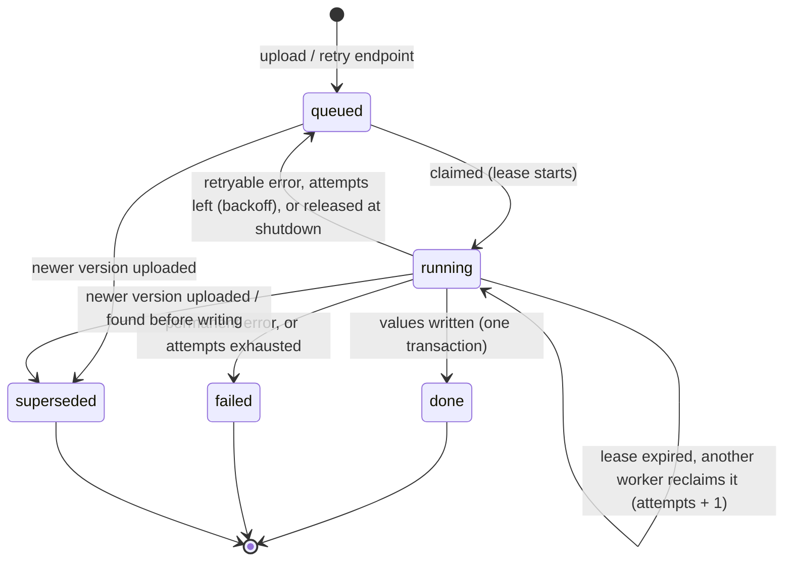

# Document Review

PDF documents go in, an LLM extracts structured values with verbatim evidence, and a reviewer approves or corrects every value before it is trusted, including when a revised version of a document arrives.

> Status: project skeleton. Sections marked _TODO_ are filled in as the features land.

## Quick start

Requirements: Node 22 (`nvm use`), pnpm 10 (`corepack enable`), Docker Desktop.

```sh
cp .env.example .env        # add your LLM_API_KEY
pnpm install
pnpm db:up                  # Postgres in Docker (host port 5433)
pnpm db:migrate             # create the schema
pnpm db:seed                # insert version 1 of the 3 fixture documents (safe to re-run)
pnpm dev                    # API on :3000, extraction worker, web on :5173
```

The worker uses a deterministic fake extractor until the LLM extractor lands (`EXTRACTOR=fake`), so seeded documents move from `queued` to `extracted` within a couple of seconds.

Check the API: <http://localhost:3000/health>

_TODO: once the api and web services are in `docker-compose.yml`, `docker compose up` alone starts everything, runs migrations and seeds version 1 of the fixtures._

## Scripts

| Command                                     | What it does                                                                                                            |
| ------------------------------------------- | ----------------------------------------------------------------------------------------------------------------------- |
| `pnpm dev`                                  | Build shared types, run the API, the worker and the web app in dev                                                      |
| `pnpm --filter @doc-review/api worker:dev`  | Run only the extraction worker (watch mode); `worker` runs the built one                                                |
| `pnpm build`                                | Build every package                                                                                                     |
| `pnpm typecheck`                            | Type-check every package                                                                                                |
| `pnpm lint`                                 | ESLint across the repo                                                                                                  |
| `pnpm format`                               | Format with Prettier                                                                                                    |
| `pnpm test`                                 | Run all tests. API tests need Postgres up; they create and migrate a separate `app_test` database and never touch `app` |
| `pnpm db:up` / `down`                       | Start / stop Postgres                                                                                                   |
| `pnpm db:migrate`                           | Apply SQL migrations from `apps/api/drizzle/`                                                                           |
| `pnpm db:seed`                              | Seed version 1 of each fixture document plus a queued job                                                               |
| `pnpm --filter @doc-review/api db:generate` | Generate a new migration after editing `apps/api/src/db/schema.ts`                                                      |

## Repository layout

```
apps/
  api/        Fastify API + extraction worker (Node, TypeScript)
  web/        React review UI (Vite)
packages/
  shared/     Field definitions, types and Zod schemas used by both apps
fixtures/     Sample PDFs and manifests provided with the assignment
```

Why this split: the API and the UI deploy separately, but must agree on field definitions, statuses and request shapes. Keeping those in `packages/shared` gives one source of truth and compile-time errors when they drift.

## Schema

Postgres is the system of record. Tables are defined in [`apps/api/src/db/schema.ts`](apps/api/src/db/schema.ts) (Drizzle), and the SQL migrations generated from it live in [`apps/api/drizzle/`](apps/api/drizzle/). Status and action enums are built from the lists in `packages/shared`, so the database, the API and the UI share one definition.

```
documents 1─* document_versions 1─* extraction_jobs
                       │
                       1─* extracted_values 1─* reviews
                              └─ previous_value_id → the same field's value on the previous version
```

| Table               | One row is…                    | Key columns                                                                                                                                         |
| ------------------- | ------------------------------ | --------------------------------------------------------------------------------------------------------------------------------------------------- |
| `documents`         | a logical document             | `type`, `title`, `fixture_key` (set only for seeded fixtures)                                                                                       |
| `document_versions` | one uploaded PDF               | `version_no`, `file_path`, `file_sha256`, `parsed_text`, `status`, `error`                                                                          |
| `extraction_jobs`   | one extraction job (the queue) | `status`, `attempts`, `run_after`, `locked_by`, `locked_until`, `heartbeat_at`, `started_at`, `finished_at`, `last_error`, `prompt`, `raw_response` |
| `extracted_values`  | one field of one version       | `field`, `value`, `evidence`, `gap_reason`, `previous_value_id`, `carried_over`                                                                     |
| `reviews`           | one approve/correct action     | `action`, `corrected_value`, `note`, `reviewer`                                                                                                     |

**Versions → values → reviews.** Every upload is a new version row, and values and reviews hang off that specific version. Nothing is updated in place or deleted: every foreign key is `ON DELETE RESTRICT`. Each version keeps its own `parsed_text`, so evidence for version N is always checked against version N's text, even after N+1 exists.

**Corrections live beside the value.** A review never overwrites `extracted_values.value`. A correction is a `reviews` row with `corrected_value` (plus an optional `note`), and the latest review for a value is its current state. This keeps what the LLM said, what the reviewer decided and the full history, which is also what re-extraction compares against.

**The current version is derived.** A document's current version is its highest `version_no`. There's no `documents.current_version_id`, because that would be a circular foreign key that has to be updated in step with every insert and could point at the wrong row.

**What the database guarantees:**

| Rule                                  | Constraint                                                                                           |
| ------------------------------------- | ---------------------------------------------------------------------------------------------------- |
| No duplicate values for a version     | `UNIQUE (version_id, field)` on `extracted_values`, so re-extracting the same version can't add rows |
| At most one open job per version      | partial unique index on `extraction_jobs (version_id) WHERE status IN ('queued','running')`          |
| No duplicate version numbers          | `UNIQUE (document_id, version_no)` on `document_versions`                                            |
| A value carries evidence, or is a gap | `CHECK` on `extracted_values`: value and evidence both set, or value null with a `gap_reason`        |
| A correction has a value              | `CHECK` on `reviews`: `action = 'correct'` requires `corrected_value`                                |
| Seeding is idempotent                 | `UNIQUE (fixture_key)` on `documents`, and the seed uses `ON CONFLICT DO NOTHING` in one transaction |

The worker claims jobs through the `(status, locked_until)` index, and `reviews (value_id, created_at)` serves "latest review per value".

**Review state is derived in one place:** the `value_review_states` view (migration `0002`). A value is `carried_over` if it was carried over from the previous version. Otherwise its latest review decides: `approve` gives `approved`, `correct` gives `corrected`, and no review means `pending`. The view also exposes `is_gap` (`value IS NULL`). The document list, the detail view and the progress counts all read this view, so they can't disagree. `reviews.created_at` defaults to `clock_timestamp()`, so two reviews in one transaction still have a well-defined latest.

**Version statuses:** `queued → extracting → extracted | failed`. An older version that was still `queued` or `extracting` when a newer version arrived becomes `superseded`, so it never stays in flight forever. The current version is never `superseded`.

## API

The API is Fastify on `:3000`. Request and response shapes are Zod schemas in [`packages/shared/src/api.ts`](packages/shared/src/api.ts), shared with the web app. JSON is camelCase and timestamps are ISO 8601.

| Method & path                           | Body                                                             | Success                                                            | Errors                  |
| --------------------------------------- | ---------------------------------------------------------------- | ------------------------------------------------------------------ | ----------------------- |
| `POST /documents`                       | multipart: `type`, `file` (PDF), optional `title`                | `202` `{ documentId, versionId, versionNo, status }`               | 400, 413, 415           |
| `POST /documents/:id/versions`          | multipart: `file` (PDF)                                          | `202` same shape                                                   | 400, 404, 409, 413, 415 |
| `GET /documents`                        | —                                                                | `200` `{ documents: [...] }` with status and progress              | —                       |
| `GET /documents/:id?version=N`          | —                                                                | `200` document, selected version, all versions and values          | 400, 404                |
| `GET /documents/:id/progress?version=N` | —                                                                | `200` `{ pending, approved, corrected, carriedOver, gaps, total }` | 400, 404                |
| `POST /values/:id/review`               | `{ action: "approve" }` or `{ action: "correct", value, note? }` | `201` the value, as in `GET /documents/:id`                        | 400, 404, 409           |
| `POST /documents/:id/retry`             | —                                                                | `202` `{ versionId, status: "queued" }`                            | 404, 409                |
| `GET /health`                           | —                                                                | `200` `{ status: "ok", database: "up" }`                           | 503                     |

```sh
# Upload a new document (type: invoice | lease | market_report)
curl -s -F type=invoice -F 'file=@fixtures/documents/invoice-001.pdf;type=application/pdf' \
  http://localhost:3000/documents
# → 202 {"documentId":"…","versionId":"…","versionNo":1,"status":"queued"}

# Upload a revised PDF as the next version of that document
curl -s -F 'file=@fixtures/documents/invoice-001.v2.pdf;type=application/pdf' \
  http://localhost:3000/documents/$DOCUMENT_ID/versions
# → 202 {"documentId":"…","versionId":"…","versionNo":2,"status":"queued"}

curl -s http://localhost:3000/documents/$DOCUMENT_ID?version=1           # an older version, read-only
curl -s -H 'content-type: application/json' -d '{"action":"correct","value":"2025-12-15","note":"Revised"}' \
  http://localhost:3000/values/$VALUE_ID/review                          # → 201 the updated value
```

**Errors.** Every non-2xx response uses one envelope: `{ "error": { "code", "message", "details"? } }`. The codes are `VALIDATION_ERROR` (400, with `details` listing each failing field), `NOT_FOUND` (404), `CONFLICT` (409), `PAYLOAD_TOO_LARGE` (413), `UNSUPPORTED_MEDIA_TYPE` (415), `BAD_REQUEST` (400, e.g. malformed JSON) and `INTERNAL_ERROR` (500). A 500 never includes the underlying message, stack or SQL.

**Why uploads return `202 Accepted`.** An upload only validates the file, stores it and inserts the version and a `queued` job in one transaction. It never waits for parsing or the LLM. The worker picks the job up later, and the UI watches the version's `status`. If the transaction fails, the stored file is removed.

**Uploads are validated before anything is stored.** The file must be declared as `application/pdf` and start with the `%PDF-` signature (otherwise 415), and must be at most `MAX_UPLOAD_MB` (default 10, otherwise 413). Files are stored under `STORAGE_DIR/<documentId>/v<versionNo>-<sha256>.pdf` (default `./storage`, which is `apps/api/storage` in dev), and the SHA-256 is recorded on the version. Re-uploading a file identical to the current version returns 409 and creates nothing.

**Correction model.** A review is appended, never edited, and the latest review wins. `correct` stores the reviewer's value beside the extracted one, which is never overwritten. Only the current version, once `extracted`, can be reviewed; older versions are read-only (409). Gaps can be reviewed too: `approve` confirms the field really is missing, and `correct` supplies the value.

**A new version while the previous one is still extracting: newest wins.** `POST /documents/:id/versions` locks the document row (`SELECT … FOR UPDATE`), so concurrent uploads get consecutive version numbers. In the same transaction it marks every open job of the older versions `superseded` (and those versions `superseded`), then inserts version N+1 with a fresh `queued` job. Nothing is deleted, and older versions stay queryable with `?version=N`. Reviews take a shared lock on the same row, so a review can't land on a version that is being replaced.

**Retry.** `POST /documents/:id/retry` only works when the current version is `failed`. It sets the version back to `queued` and adds a new job. The partial unique index guarantees there is never more than one open job per version.

## How extraction is coordinated

An upload only inserts a version and a `queued` row in `extraction_jobs`. A separate **worker process** ([`apps/api/src/worker/`](apps/api/src/worker/)) turns those rows into results. **Postgres is the only coordination mechanism.** There's no Redis and no queue library: the job is a row in the same database as the data it produces, so claiming, writing results and changing state are ordinary transactions, and a restart loses nothing.



The version mirrors its job: `queued` → `extracting` → `extracted` | `failed` (or `superseded`). While a retry is pending, the version is back to `queued` and `error` explains the failed attempt.

**Claiming.** Each worker runs `WORKER_CONCURRENCY` slots, and an idle slot polls every `WORKER_POLL_INTERVAL_MS`. A claim is one transaction ([`jobs.repository.ts`](apps/api/src/repositories/jobs.repository.ts)):

```sql
WITH next_job AS (
  SELECT id FROM extraction_jobs
  WHERE (status = 'queued'  AND run_after    <= now())   -- due (backoff elapsed)
     OR (status = 'running' AND locked_until <  now())   -- its worker died
  ORDER BY created_at
  FOR UPDATE SKIP LOCKED
  LIMIT 1
)
UPDATE extraction_jobs j
SET status = 'running', locked_by = $workerId, locked_until = now() + $lease,
    heartbeat_at = now(), attempts = attempts + 1, started_at = now()
FROM next_job WHERE j.id = next_job.id
RETURNING ...;   -- then, same transaction: version → 'extracting'
```

`SKIP LOCKED` lets any number of workers claim at once without blocking each other or taking the same job. Two partial indexes serve the two halves of the `WHERE`.

**Leases and heartbeats.** A claim is a lease (`JOB_LEASE_SECONDS`, default 120). While the extractor runs, a heartbeat renews it every lease/3, so a slow LLM call isn't reclaimed. Every lease comparison uses the database clock (`now()`), never a worker's clock.

**Fencing.** Every write that ends or hands back an attempt (done, retry, failed, superseded, released) is conditional on `id = $job AND status = 'running' AND locked_by = $workerId`. If a worker stalled past its lease and another worker reclaimed the job, the stale worker's write matches 0 rows. Its result is discarded and logged as `lease_lost`, and it can never overwrite the newer attempt. A heartbeat that finds the lease gone aborts the extraction early.

**Retries and failure.** Errors are classified:

- **Retryable:** timeouts, rate limits, dropped connections.
- **Permanent:** an unreadable PDF, or extractor output that fails the shared Zod schema.

A retryable error with attempts left (`JOB_MAX_ATTEMPTS`, default 3) re-queues the job with `run_after = now() + backoff`. The backoff is exponential (`JOB_BACKOFF_BASE_MS · 2^(attempt-1)`) with jitter, capped at 5 minutes. Otherwise the job and the version become `failed` with a readable `error`, and `POST /documents/:id/retry` re-queues it. The worker loop catches everything, so one bad job never stops it.

**Crash recovery.** If a worker is killed (`kill -9`, OOM, container restart), its jobs stay `running` until their lease expires, and then the claim query picks them up again with attempts + 1. No manual reset is needed, and nothing stays `extracting`. A job that dies on every attempt is failed once attempts run out. On startup the worker logs how many expired leases it's about to recover.

**Shutdown.** On SIGINT/SIGTERM the worker stops claiming and waits up to `WORKER_SHUTDOWN_TIMEOUT_MS` for in-flight jobs. Anything still running is then released, fenced, back to `queued`. That doesn't count as an attempt, because the job didn't fail.

**Supersede.** Newest wins. Uploading version N+1 marks older open jobs `superseded`, including a running one, whose fenced completion then writes nothing. As a second guard, the completing transaction share-locks the document row and re-checks that the version is still the latest before writing. If it isn't, the job becomes `superseded` and no values are written.

**Idempotent results.** A result is written in one transaction: job `done` (with `prompt` and `raw_response`), every value, and version `extracted`. Values are inserted `ON CONFLICT (version_id, field) DO NOTHING`, on top of the `UNIQUE (version_id, field)` constraint. However a version ends up extracted twice (retry, crash recovery, an impatient user), it never gets duplicate values.

**Observing it.** The worker writes one JSON log line per job: `jobId`, `versionId`, `attempt`, `workerId`, `durationMs` and `outcome` (`done | retry | failed | superseded | released | lease_lost | abandoned`). Document text, evidence and secrets are never logged. Each job keeps its `prompt`, `raw_response` and `last_error`. To see the queue:

```sh
docker compose exec db psql -U app -d app -c \
  "select status, count(*), max(attempts) as max_attempts from extraction_jobs group by status"
```

The extractor is an interface ([`extraction/extractor.ts`](apps/api/src/extraction/extractor.ts)). `EXTRACTOR=fake` (the default for now) returns deterministic values. `FAKE_EXTRACTOR_BEHAVIOR=retryable|permanent` and `FAKE_EXTRACTOR_DELAY_MS` simulate failures and slow calls, which is handy for trying crash recovery by hand.

## Decisions

- **Correction model:** corrections live beside the extracted value as append-only reviews, and the latest wins. See [API](#api).
- **New version during extraction:** newest wins. Older open jobs are `superseded`, and nothing is deleted. See [API](#api).

_TODO: what "unchanged evidence" means, polling vs streaming._

## What I cut and what's next

_TODO_

## At 10,000 documents

_TODO_
