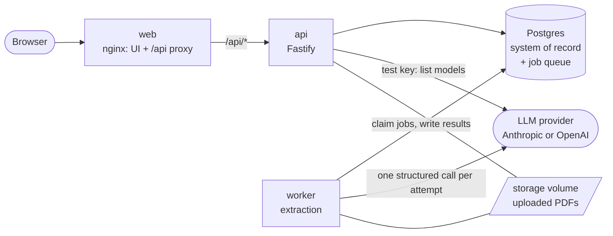
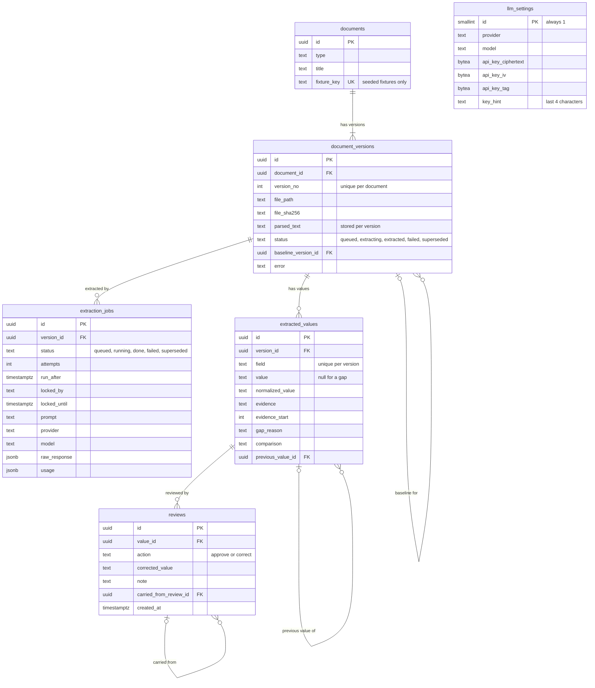
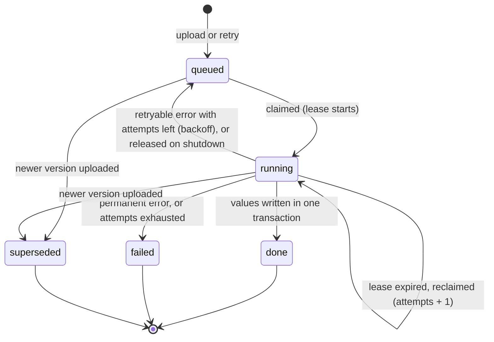

# Document Review

Upload a PDF (invoice, lease or market report). A background worker parses its text and asks an LLM for the document type's fields. Every value must quote the passage it came from, and that quote is checked verbatim against the document's text; a value whose quote isn't found becomes a **gap** with a reason, never a guess. A reviewer approves or corrects each value beside its quote. When a revised PDF arrives as a new version, values whose evidence didn't change keep their review (**carried over**), and only the changed ones go back to the reviewer.

## Quick start

You need Docker Desktop, Git, and an Anthropic or OpenAI API key.

```sh
git clone https://github.com/Wec-development/wec-doc-review.git && cd wec-doc-review
docker compose up --build
```

The first build takes a few minutes. Postgres starts, migrations run, version 1 of the three sample documents is seeded, and the API, worker and web UI start.

Open <http://localhost:8080>, then **Settings**:

1. Choose the provider: Claude (Anthropic) or OpenAI.
2. Paste the API key and click **Test connection**.
3. Keep the pre-selected low-cost model.
4. Click **Save settings**.

The three seeded documents then extract on their own. Until an LLM is saved they stay `queued` behind a banner: that is the expected first-run state, not an error. No key goes into any file.

Ports already taken? See [Troubleshooting](#troubleshooting).

## What to click first

1. **Market report:** `median_household_income` is a **gap** with its reason, and stays visible. Each value sits beside its source quote; **Show in document text** scrolls the parsed text on the right to the highlighted passage.
2. **Invoice:**
   - Approve its values (or **Correct…** one: a value is required, the note optional).
   - Then **Upload new version** with `fixtures/documents/invoice-001.v2.pdf`.
   - Once it's extracted, exactly **2 values** need review (`due_date`, `total_amount`), each with a "Previously in v1" box showing the old value, quote and review.
   - The other **3 are carried over** with their reviews.
3. **Version switcher → v1:** still there, unchanged and read-only.
4. **Restart test:** upload any PDF and, while it shows _Extracting_, run `docker compose restart` (or `docker compose kill worker && docker compose up -d worker`) in a second terminal. The document finishes after the restart or becomes visibly `failed` with **Retry**. It never stays _Extracting_.

The first visit opens a short **How it works** page; it can be reopened from the header.

## Repository layout and why

```
apps/api/         Fastify HTTP API and the extraction worker (two entry points, one codebase)
apps/web/         React + Vite review UI, served by nginx in Docker
packages/shared/  Field definitions, statuses and Zod schemas for every request and response
fixtures/         Sample PDFs and manifests from the brief
docs/             Detail behind this README
```

A pnpm workspace with three packages, split along what deploys and what must agree:

- **`packages/shared` is the contract.**
  - The API validates requests with these schemas, and the web client parses every response with them.
  - The database enums are built from the same lists.
  - Change a field or a status in one place, and every package fails to compile until it agrees.
  - It holds no I/O and no framework code.
- **The API and the worker share `apps/api`.** They need the same repositories, schema and domain errors. They are separate processes: `dist/index.js` and `dist/worker/index.js`, separate Docker services from one image. So the boundary is the process, not the package. A third package for the worker would only add indirection.
- **`apps/web` only talks HTTP.** It never imports API code, only `packages/shared`, and every call goes through [`api/client.ts`](apps/web/src/api/client.ts).

## Architecture



The `docker compose up` services:

| Service   | Why it exists                                                                                                                                                                               |
| --------- | ------------------------------------------------------------------------------------------------------------------------------------------------------------------------------------------- |
| `db`      | Postgres 16: documents, versions, values, reviews, the job queue and the encrypted LLM key. The only infrastructure.                                                                        |
| `migrate` | A one-shot job: migrations, then the idempotent seed, then it exits 0. The API and worker start only after it succeeds, so replicas never race to migrate or run on a half-migrated schema. |
| `api`     | The HTTP API. Uploads only store the file and insert rows; it never calls the LLM for extraction. Healthcheck: `GET /health`.                                                               |
| `worker`  | Turns queued jobs into values. A separate service, so it can be restarted, killed or scaled (`--scale worker=2`) without touching the API.                                                  |
| `web`     | nginx serving the built UI and proxying `/api` to the API: same-origin requests, no CORS, and no API URL baked into the build.                                                              |

**Volumes.** These survive `docker compose down`; only `down -v` deletes them:

- `pgdata`: the database;
- `storage`: uploaded PDFs;
- `secrets`: the encryption key, mounted into the API and worker only.

**Images.** Multi-stage builds, run as non-root users with `NODE_ENV=production`. They contain no `.env` and no dev dependencies.

## Schema

Postgres is the system of record. The tables are in [`apps/api/src/db/schema.ts`](apps/api/src/db/schema.ts) (Drizzle), and the SQL migrations are in [`apps/api/drizzle/`](apps/api/drizzle/).



**How versions, values and reviews relate.**

- Every upload is a new `document_versions` row.
- Values belong to one version.
- Reviews belong to one value.
- Nothing is updated in place or deleted: every foreign key is `ON DELETE RESTRICT`.

So version N, its values and their reviews stay exactly as they were after N+1 arrives.

**Why it's shaped this way:**

- **Corrections live beside the value.** A review never overwrites `extracted_values.value`. A correction is a `reviews` row with `corrected_value` and an optional note. This keeps what the LLM said, what the reviewer decided and the full history; re-extraction compares against them.
- **Reviews are append-only; the latest one wins.** The review state (`pending`, `approved`, `corrected`, `carried_over`) is derived in one SQL view, `value_review_states`. The list, the detail page and the progress counts all read it, so they can't disagree.
- **Carried reviews keep their provenance.** Carrying a review over copies it as a new row on the new value, with `carried_from_review_id` pointing to the original, so the chain can be followed back to the first decision.
- **The current version is derived:** it's the highest `version_no`. A `documents.current_version_id` column would be a circular foreign key that has to be kept in step with every insert.
- **Parsed text is stored per version**, so evidence for version N is always checked and highlighted against N's own text.

**What the database guarantees:**

| Rule                                  | Constraint                                                                                  |
| ------------------------------------- | ------------------------------------------------------------------------------------------- |
| One version number per document       | `UNIQUE (document_id, version_no)`                                                          |
| One value per field per version       | `UNIQUE (version_id, field)`, so re-extraction can't duplicate                              |
| At most one open job per version      | partial unique index on `extraction_jobs (version_id) WHERE status IN ('queued','running')` |
| A value carries evidence, or is a gap | `CHECK`: value and evidence both set, or value null with a `gap_reason`                     |
| A correction has a value              | `CHECK`: `action = 'correct'` requires `corrected_value`                                    |
| A review is carried at most once      | `UNIQUE (value_id, carried_from_review_id)` where carried                                   |
| One LLM settings row                  | `CHECK (id = 1)`                                                                            |
| Idempotent seed                       | `UNIQUE (fixture_key)` and `ON CONFLICT DO NOTHING`                                         |

## How extraction is coordinated

An upload inserts a version and a `queued` row in `extraction_jobs`, then returns `202`. A separate **worker** process ([`apps/api/src/worker/`](apps/api/src/worker/)) turns those rows into results. **The queue is a Postgres table:** a job lives in the same database as the data it produces. Claiming it, writing results and changing state are ordinary transactions, and a restart loses nothing.



The version mirrors its job: `queued` → `extracting` → `extracted` | `failed` | `superseded`.

- **Claim:** one transaction ([`jobs.repository.ts`](apps/api/src/repositories/jobs.repository.ts)).
  - It selects the oldest job that is either `queued` and due, or `running` with an expired lease, `FOR UPDATE SKIP LOCKED LIMIT 1`.
  - It marks the job `running` with `locked_by`, `locked_until = now() + lease` and `attempts + 1`, and the version `extracting`.
  - Any number of workers claim concurrently without blocking each other or getting the same job.
- **Leases and heartbeats:**
  - A claim is a lease (`JOB_LEASE_SECONDS`, 120 s).
  - A heartbeat renews it every lease/3 while the LLM call runs.
  - All lease times use the database clock.
- **Fencing:**
  - Every write that ends an attempt (done, retry, failed, released) carries `WHERE status = 'running' AND locked_by = $me`.
  - A worker that stalled past its lease and was replaced matches 0 rows: its result is discarded and logged as `lease_lost`.
- **Retries:**
  - Errors are classified. Timeouts, rate limits, 5xx and malformed output are retryable; unreadable PDFs, auth failures and refusals are permanent.
  - A retryable error re-queues the job with exponential backoff and jitter, up to `JOB_MAX_ATTEMPTS` (3).
  - After that the version is `failed` with a readable reason, and **Retry** (`POST /documents/:id/retry`) queues it again.
- **Crash recovery:**
  - A killed worker's job stays `running` until its lease expires, then any worker reclaims it. No manual reset.
  - On `SIGTERM` (`docker compose restart`), the worker stops claiming, gives in-flight jobs 10 s to finish, and hands the rest back to `queued` without using an attempt.
- **Idempotent writes:** the job's `done` status, every value, the carried reviews and the version's `extracted` status commit in **one** fenced transaction. Values use `ON CONFLICT (version_id, field) DO NOTHING`, on top of the unique constraint. A retry, a crash recovery or an impatient user can't duplicate anything.
- **Supersede (newest wins):**
  - Uploading version N+1 locks the document row and marks older open jobs and versions `superseded`, in the same transaction that inserts N+1.
  - As a second guard, the completing transaction re-checks that its version is still the latest before writing.
- **Paused without an LLM:** while no LLM is saved, the worker doesn't claim at all, so jobs wait without using attempts.

## Extraction and evidence

The pipeline, for one job:

1. **Parse** the stored PDF with pdfjs-dist, and store the raw text on the version.
2. **One structured model call:** Anthropic structured outputs or OpenAI strict JSON schema. The output shape is fixed: `{ field, value, evidence, not_found_reason }` per field.
3. **Zod-parse** the reply. A malformed reply is retryable.
4. **Verify each field in code:**
   - The evidence must appear **verbatim** in _this version's_ text. Only Unicode NFKC and whitespace runs are normalised; case, punctuation and digits are not.
   - The value must be stated by its own evidence. For example, the subtotal line quoted for the total fails.
   - The value must normalise as its type: date, money, percent, number, string.
5. **Store.** Anything that fails becomes a gap with a reason: `Quoted evidence not found in document text`, `Value not supported by its evidence`, the model's own "not found" reason, and so on. A gap is never hidden and never filled with a guess.

Every attempt stores `prompt`, `prompt_version`, `provider`, `model`, `raw_response`, token `usage` and duration on the job row, on failure too.

**Prompt injection.**

- The document is passed inside `<document>` tags as untrusted data.
- More importantly, nothing the model returns is trusted: an injected instruction can at most produce a gap.
- Logs never contain document text or keys.

Matching and normalisation rules, the error mapping, and how recorded replies work: [docs/extraction.md](docs/extraction.md).

## Re-extraction and carry-over

When version N+1 is extracted, each field is compared with the **baseline**: the most recent earlier version that finished extracting. Failed and superseded versions are skipped. The baseline is stored as `baseline_version_id`.

**"Unchanged" means all three hold:**

1. the **normalised values are equal** (e.g. `5230.29 USD`);
2. the baseline's evidence appears verbatim in the **new** version's text;
3. the new evidence appears verbatim in the **baseline's** text.

Positions are never compared, so an added paragraph, reflowed lines or a moved section doesn't count as a change. The check runs in both directions, so the rule holds even when the model quotes a slightly different passage for the same fact: both passages must exist in both texts. Any edit inside a quoted passage breaks the match.

**What happens to each field:**

- **Unchanged, with a review:** the review is copied to the new value with `carried_from_review_id`, and the value is shown as _carried over_ with no actions.
- **Changed:** the value goes back to _pending_, linked by `previous_value_id`, so the UI shows the previous value, quote and review beside it.
- **Gaps:** a gap that is "not found" in both versions is unchanged. Every other gap transition is changed, so a person looks again.

Comparison, values and carried reviews commit in the job's single transaction. The pure function is [`compareVersions`](apps/api/src/extraction/carry-over/compare-versions.ts), and every outcome is tabled in [docs/extraction.md](docs/extraction.md#re-extraction-field-by-field-comparison).

**Worked example.** Approve invoice v1, correct `vendor_name`, then upload `invoice-001.v2.pdf`:

| Field            | v1 → v2                     | Result                                                   |
| ---------------- | --------------------------- | -------------------------------------------------------- |
| `invoice_number` | `INV-2025-0847`, same line  | carried over (approved)                                  |
| `issue_date`     | `2025-09-14`, same line     | carried over (approved)                                  |
| `vendor_name`    | same line                   | carried over (corrected, same value and note)            |
| `due_date`       | `2025-10-14` → `2025-11-13` | **pending** (`value_differs`), v1 value and review shown |
| `total_amount`   | `$5,230.29` → `$6,126.45`   | **pending** (`value_differs`), v1 value and review shown |

v2 also retitles the invoice `INVOICE (REVISED)` and inserts a paragraph that shifts every later line. Because positions aren't compared, neither change touches the three unchanged fields.

**Known limitations.**

- An identical passage whose surrounding context changed meaning is still "unchanged". For example, the same "Total Due" line under a new heading that voids the invoice.
- If the model quotes a passage that exists in both versions but now refers to something else, only the human review catches it.

## Decisions

| Decision                      | Options considered                                          | Choice                                                                      | Why                                                                                                                                                                                                                       |
| ----------------------------- | ----------------------------------------------------------- | --------------------------------------------------------------------------- | ------------------------------------------------------------------------------------------------------------------------------------------------------------------------------------------------------------------------- |
| Correction model              | Overwrite the value; annotation beside it                   | **Beside it**: append-only `reviews`, latest wins                           | Keeps what the LLM said and the full history; re-extraction needs the original value and evidence to compare; an audit trail costs nothing extra.                                                                         |
| What "unchanged" means        | Same value; same position or line; text diff; same evidence | **Same normalised value + each quote verbatim in the other version's text** | Positions break as soon as anything is inserted above. A diff is noisy. The two-way verbatim check survives reflow and still catches any edit to the quoted passage.                                                      |
| New version during extraction | Reject (409); queue behind the old one; supersede           | **Supersede: newest wins**                                                  | The old result would be stale on arrival. Rejecting pushes the problem onto the user, and queueing spends money on a version nobody reviews. Nothing is deleted; the old version stays queryable.                         |
| Live status in the UI         | Polling; SSE; WebSockets                                    | **Poll every 3 s, only while something is queued or extracting**            | Extraction takes seconds and only follows a user action. Polling stops when everything has settled, works through any proxy, and needs no connection management.                                                          |
| Parsed text                   | Re-parse on demand; store per version                       | **Store per version**                                                       | Evidence offsets and highlighting must point into exactly the text that was verified, even if the parser is upgraded later. The text is a few KB per version.                                                             |
| Job queue                     | Redis/BullMQ; pg-boss; a Postgres table                     | **A Postgres table with `SKIP LOCKED`**                                     | The brief makes Postgres the system of record. Results and job state commit in one transaction, which makes idempotency and fencing simple. Another service would have to earn its place, and at this volume it doesn't.  |
| LLM provider, model and key   | `.env` variables; settings in the database                  | **Settings in the app, key encrypted in Postgres**                          | A reviewer can run `docker compose up` with nothing to edit. It's testable from the UI, switchable without a restart, and never written to a file. A wrong-provider key fails at **Test connection**, not mid-extraction. |
| Accepted files                | PDF and images (OCR); PDF only                              | **Text PDFs only, ≤ 10 MB**                                                 | The brief and fixtures are PDFs. OCR adds a second error-prone stage. Scanned PDFs fail with a clear reason rather than producing poor text.                                                                              |
| Uploads                       | Parse and extract in the request; enqueue                   | **Enqueue and return 202**                                                  | "Uploading must feel instant", and the LLM can take tens of seconds or fail.                                                                                                                                              |

## LLM settings and security

- **Where the key lives.** The key is entered in **Settings** and stored in `llm_settings`, encrypted with **AES-256-GCM**: a random 12-byte IV per save, with the auth tag and `key_version` stored too. A tampered row fails to decrypt.
- **The encryption key is never in the database.** It comes from `APP_ENCRYPTION_KEY` (32 bytes, base64) if set. Otherwise it's generated once into `secrets/encryption.key` with mode 0600; in Docker that file lives on the `secrets` volume, which only the api and worker mount.
- **Never returned, never logged.**
  - The API returns only the last 4 characters (`keyHint`).
  - Request bodies are never logged, and the logger redacts `apiKey` and auth headers.
  - The worker decrypts the key per job, at the moment of the call.
- **Verified before saving.** **Test connection** calls the provider's free list-models endpoint, rate-limited to 10 per minute per client. Saving re-checks server-side and only accepts a model that key can use.
- **Limitation: there is no authentication.** Sign-in was out of scope, so anyone who can reach the app can replace the key, review values and upload files. A real deployment needs sign-in, an admin role for Settings, and reviewer identity on each review (today it's a fixed `reviewer`).

## Tests

```sh
pnpm test              # everything; needs Postgres (pnpm db:up). Uses a separate app_test database.
pnpm test:unit         # pure logic and React components (jsdom)
pnpm test:integration  # real Postgres: API via app.inject, worker, carry-over, recovery
pnpm test:e2e          # HTTP in, real worker process, real PDF parsing, recorded LLM replies
pnpm test:coverage     # what CI runs; gates ≥ 90% on the critical modules
```

- **No test calls a real LLM.** Replies recorded from the real models are replayed into the real Anthropic and OpenAI SDK clients through an injected `fetch`, so prompts, structured output parsing and error mapping are exercised as in production.
- **What the acceptance suite proves:**
  - the three fixtures extract, with the income gap;
  - invoice v1 → v2 leaves exactly 2 pending and 3 carried over, with v1 unchanged;
  - a made-up quote becomes a gap;
  - an LLM error fails the version, and retry recovers it;
  - a worker process killed with `SIGKILL` mid-extraction has its job finished by another, with no duplicates;
  - a new version supersedes a running extraction;
  - non-PDFs are rejected.
- **Coverage gate:** ≥ 90% lines and branches on evidence verification, `compareVersions`, job claiming and fencing, secret encryption, and the UI's review-state helpers.
- **The tests catch breakage.** Breaking each guard on purpose fails at least one test.
- **Docker checks:** CI also builds the images and runs `scripts/smoke.sh` and `scripts/restart-test.sh --kill`.

Requirement → test mapping: [docs/test-matrix.md](docs/test-matrix.md). API reference: [docs/api.md](docs/api.md).

## Development

Run the apps on your machine with hot reload, with only Postgres in Docker. Requirements: Node 22 (`nvm use`) and pnpm 10 (`corepack enable`).

```sh
cp .env.example .env   # no secrets needed: the LLM is configured in the app
pnpm install
pnpm db:up             # Postgres on localhost:5433
pnpm db:migrate
pnpm db:seed           # version 1 of the 3 fixtures; safe to re-run
pnpm dev               # API :3000, worker, web :5173 (proxies /api like nginx)
```

Stop the Docker stack first (`docker compose down`): both use ports 3000 and 5433. Set `EXTRACTOR=fake` in `.env` to click through without a key.

| Command                                           | What it does                                                   |
| ------------------------------------------------- | -------------------------------------------------------------- |
| `pnpm format` / `lint` / `build` / `typecheck`    | Prettier, ESLint, build and type-check every package           |
| `pnpm --filter @doc-review/api db:generate`       | Generate a migration after editing `apps/api/src/db/schema.ts` |
| `pnpm docker:up` / `docker:down` / `docker:reset` | Start (building) / stop / wipe and restart the Docker stack    |
| `pnpm docker:logs`                                | Follow the api and worker logs                                 |
| `pnpm docker:smoke` / `docker:restart-test`       | The Docker checks CI runs, in an isolated compose project      |

Inspect the database and the queue:

```sh
docker compose exec db psql -U app -d app
docker compose exec db psql -U app -d app -c \
  "select status, count(*), max(attempts) from extraction_jobs group by status"
```

## What I cut and what I'd do next

**Cut, deliberately:**

- **Authentication and reviewer identity.** Every review is by `reviewer`, and Settings is open to anyone who can reach the app.
- **OCR.** Scanned PDFs fail with a clear reason.
- **A live deployment.** It runs locally with one command.
- **Per-file document type in multi-upload.** One type applies to every file in a batch.
- **Real-browser tests.** Components are tested in jsdom; there is no Playwright.
- **Encryption-key rotation.** `key_version` is stored, so it can be added without a migration.
- **SQL pagination for the documents list.** It's paged in the browser, 25 at a time.

**Known issue:** a job superseded by an upload keeps `finished_at` empty. Its status is correct; only that timestamp is missing.

**Next:**

1. Sign-in, an admin role for Settings, and the reviewer's identity on each review.
2. Highlight the evidence on the PDF page itself, not only in the parsed text.
3. Per-file type in multi-upload, and type detection as a suggestion.
4. A Playwright smoke test of the review flow.
5. Fix the `finished_at` timestamp.

## At 10,000 documents

The design holds; what changes is operations and cost.

- **Workers:**
  - Scale `worker` horizontally; `SKIP LOCKED` already gives each job to one worker.
  - Cap concurrency **per provider** to its rate limit, and back off on 429 using the provider's retry-after.
  - Keep the claim index small by archiving `done` jobs.
- **Database:**
  - Page `GET /documents` in SQL, with indexes for the list's sort and filters, and keep progress counts as a maintained summary rather than computed per request.
  - Once tables reach tens of millions of rows, partition `extracted_values` and `reviews` by time or tenant.
  - Move `raw_response` and `prompt` to cheaper storage after N days.
- **Files:** store PDFs in object storage (S3 or GCS) behind the existing `FileStorage` interface, instead of a shared volume.
- **Cost controls:**
  - A per-tenant budget, and a daily spend from the stored `usage`.
  - The provider's batch API for bulk backfills.
  - Skip the LLM entirely when a new version's file hash is identical (this already returns 409).
- **Observability:**
  - Metrics for queue depth, oldest queued age, attempts, failure rate by reason, LLM latency and tokens.
  - Traces from upload to extracted.
  - Alerts on queue age and failure spikes.
- **Search:** full-text search over `parsed_text` and values (Postgres `tsvector` first).
- **Archiving:** move versions older than the baseline and their jobs to an archive table or cold storage. They stay queryable, never deleted.
- **Auth and multi-tenancy:** a `tenant_id` on every table, row-level security, per-tenant LLM settings and keys.
- **Queue technology:** add `LISTEN/NOTIFY` to cut polling latency, or move to a dedicated queue, only when measured claim latency or database load says the table is the bottleneck.

## Troubleshooting

- **A port is already in use (8080, 3000 or 5433).** Pick other host ports:
  ```sh
  WEB_HOST_PORT=8081 API_HOST_PORT=3001 DB_HOST_PORT=5434 docker compose up --build
  ```
- **The first start failed half-way** (an interrupted build, an old volume):
  ```sh
  docker compose down -v --remove-orphans && docker compose up --build
  ```
- **Logs:** `docker compose logs -f api worker`. A `migrate` that didn't exit 0 is shown by `docker compose logs migrate`.
- **Documents stay `queued`:** no LLM is saved yet. Open **Settings**.
- **`LLM authentication failed — update the API key in Settings`:** the provider rejected the saved key. Replace it in Settings, then click **Retry** on the document.
- **Reset everything** (database, uploads and the encryption key; the samples are re-seeded): `docker compose down -v`, then `docker compose up --build`.

## AI usage

AI coding tools (Claude Code) were used throughout, as the brief allows. The full session logs are submitted alongside the repository. The design decisions are mine and are documented above: the schema, the queue, the "unchanged" rule, the correction model, supersede and the security model.
